# Spec: the first prompt of a fourth session waits ten minutes

Replaced by `2026-11-24-cogload-active-sessions-warning-design.md`; only the
`sessions` field of `cogload status` is left.

Extends `2026-09-19-zapara-status-file-design.md` (one field),
`2026-10-29-cognitive-load-powerbank-design.md` (the skip and its five a week)
and `2026-11-17-cognitive-load-queued-prompts-design.md` (Enter during a rest
sends the box when it ends). Everything not mentioned here stays as they say.
Part of [#253](https://github.com/drakulavich/cogload/issues/253).

## Objective

The number of sessions in an hour moves the index more than anything else.
Over 2026-10-24 to 2026-11-22 the mean index of an hour on the work Mac was 7,
20, 36, 55 and 76 for 1, 2, 3, 4 and 5+ sessions; at home 10, 22, 32, 63, 76
([#253 comment](https://github.com/drakulavich/cogload/issues/253)). 190 of the
work Mac's 310 active hours (61%) had four or more sessions. A note in the
band is easy to read past, as the 40-minute rest was before the plugin held
prompts. So the plugin holds the step that makes four: the first prompt of a
fresh session while three others already count.

After this change:

1. A session checks its first composer prompt once and marks itself
   `asked` in `$.state`; later prompts are never checked, since a dropped
   prompt writes no record and `turns()` stays 0 after it. The prompt is
   held when `turns() === 0`, the stored reading shows `sessions` exactly 3,
   and `fourSeenAt` is absent or 60 minutes old or more.
2. `fourSeenAt` is the latch. A held session writes no record, so the count
   stays 3 for the whole hold: the hold writes `now` to the latch when it
   starts, and a second fresh session a minute later passes. Every minute, a
   session whose reading shows 4 or more writes the later of the stored
   value and its reading's `asOf`, so a fifth session, or a new one after
   another went quiet, passes. The hold re-arms only after an hour below
   four, as an hourly crossing measures. The latch is a plain `get` then
   `set`, not a claim (see Data and cost).
3. The hold lasts `restMin` minutes (10) from that prompt and ends on its own.
   It holds this session only; the other three keep working. During it the
   session behaves as during a rest: Enter queues the box, which is sent at
   the first minute after the hold (and any rest) has ended; a prompt with an
   attachment goes back into the box; text typed without Enter stays a draft.
   The box goes through the plugin's own `$.prompt.submit`, which reaches
   every hook but the caller's, with origin `plugin` (engine types,
   `prompt.submit`), so the rule never sees it.
4. A `skip:` line with a reason of three words or more lifts the hold and any
   running rest, and spends one of the five skips a week. With none left it
   gets the empty-powerbank text and the hold runs out on its own.
5. A rest that is running or starts during the hold holds the prompt too. The
   box goes when both have ended: the wait is the later of the two ends.
6. A Remote Control prompt passes, as during a rest, with no note. A fresh
   session whose reading is missing or older than 5 minutes (`STALE_MS`), or
   whose cogload is older than this field, is not held.
7. Each hold adds its start to the store key `fourthHolds`, kept for a week;
   the `/cogload` week line counts them, and a hold alone shows the line.

## Approaches

### 1. What counts as a session

| Option | Cost | Verdict |
|---|---|---|
| A. The live bucket's `sessions` from `cogload status`: distinct sessions with a record in the last 60 minutes, the index's own count | +13 bytes in `status.json`; a session closed 30 minutes ago counts for 30 more | **Chosen** |
| B. The plugin's own count of open sessions: each session writes a heartbeat to the store every minute, `session.end` removes it | A map key every session rewrites each minute, so one write can drop another's entry; idle sessions left open for days count; sessions started before the update and machines without the plugin are missing | Rejected |

A measures what the index scores and what the 61% counts, so the hold and its
measure agree. B would hold for an open session idle for hours, which adds
nothing to the index. A's lag is accepted: a session closed half an hour ago
still scores as one of the hour's sessions.

Subagents, `claude -p` and Agent SDK runs, and copied background history
already drop out of A in the parser (`isSidechain`, `entrypoint` `sdk-`, the
`bg` dedupe of `2026-10-17-cogload-copied-history-design.md`). No new filter.
The plugin only sees composer and bridge prompts, so a scripted session is
never held either. A `/clear` starts a new session id with `turns() === 0`,
and the index counts it as a new session, so the hold does too. A `--resume`
session has `turns() > 0` and is never held.

### 2. When the hold ends

| Option | What a month at work would have done | Verdict |
|---|---|---|
| A. When the count drops below four | Runs of 4+ hours last a median of 4 h, p90 10 h, max 11 h; 17 of 37 last 6 h or more. The 60-minute window adds up to an hour after a session goes quiet. No end the user can foresee | Rejected |
| B. A fixed `restMin` (10 min), ending on its own | 8 to 12 holds a week (37 in the month, below), 80 to 120 minutes of delayed first prompts a week, no skip needed; the band shows the end from the start | **Chosen** |
| C. Only by a skip | 8 to 12 skips a week against five: the powerbank is empty by Wednesday and rests run unskippable for the rest of the week | Rejected |

### 3. With a rest and the five skips

| Option | Cost | Verdict |
|---|---|---|
| A. The hold waits for the rest, then runs its ten minutes | Up to 20 minutes for one prompt | Rejected |
| B. Both run side by side; the box goes when the later one ends | One `max` of two end times | **Chosen** |
| C. A rest replaces the hold | A rest with two minutes left gives a two-minute hold | Rejected |

The hold needs no skip, so the five are spent only by choice (the owner's
call, 2026-11-22). One skip in the held session lifts both; a skip in another
session lifts the rest there and leaves this session's hold alone.

## How often it fires

From the hourly buckets (`sessions` per clock hour): a crossing is an hour
with 4+ sessions after an hour with fewer.

| | Work | Home |
|---|---|---|
| Crossings in the month | 37, on 22 of 26 active days | 10, on 6 of 28 |
| Per full week | 9, 8, 8, 12 | 8, 0, 0, 1 |
| Fresh sessions opened in 4+ hours (estimate) | 177, 37 to 52 a week | 13 |

The last row is what holding every later session would have done, so rule 1
holds only the crossing. The live rule can sit off the 8 to 12 either way, by
an amount the hourly JSON cannot give:

- Lower: a crossing made by a resumed session (`turns() > 0`) is not held, and
  an hourly bucket with four distinct sessions may never have had three in
  the window at a fresh session's first prompt.
- Higher: a dip below four of more than an hour that does not fill a clock
  hour re-arms the live rule but shows no crossing in the buckets.
- Either: hours when no session ran the plugin write no `fourSeenAt`; the
  accepted race adds a second hold now and then.

## The hold's states

```mermaid
stateDiagram-v2
    [*] --> Fresh
    Fresh --> Open: first prompt, rule 1 not met
    Fresh --> Held: first prompt, 3 others, latch clear; sets latch
    Held --> Held: a rest starts, box waits for the later end
    Held --> Held: skip with no skips left
    Held --> Open: skip, spends one of five
    Held --> Open: hold and rest over, queued box sent
    Open --> [*]
```

## Data and cost

- **`status.json`** gains a twelfth field, `sessions`, after `restMin`: the
  live bucket's count, an integer from 0. The line grows by 13 bytes
  (`,"sessions":3`), from 190 in the line printed today. Adding a field does
  not bump `schema`, which stays 1 (status-file spec). `decodeStatus` reads a
  missing `sessions` as unknown, which never holds and raises no older-cogload
  toast. The `reading` store key stays an object.
- **`fourSeenAt`**, a new store key: one number, milliseconds, about 14 bytes.
  Written by a hold when it starts, and once a minute by each session whose
  reading shows 4 or more, the rhythm `reading` has today.
- **No claim across sessions.** `$.store` has only `get`, `set` ("Sets
  `key` to `value`") and `delete`, so the last write wins; `register.ts`'s
  `update` works on `$.state`, "held by the host for the session". Two
  fresh sessions whose first-prompt hooks overlap between the latch's `get`
  and `set` (milliseconds of store I/O) both hold: each waits at most ten
  minutes and both boxes are sent. A lock is not worth that (`simplicity.md`);
  the race is accepted. A per-minute write that overlaps the hold's can set
  the latch back by its reading's age (a minute, at most five), so it re-arms
  that much early; a lost per-minute write is repeated the next minute.
- **`fourthHolds`**, a new store key: a list of numbers, the start of each hold
  for seven days, trimmed on each write as `rests` is. About 14 bytes an
  entry; 12 a week at work is about 170 bytes. A flag for a hold a skip lifted
  was considered and dropped: nothing reads it now. Only the race above
  writes it twice at once; the lost entry then counts that crossing once.
- **`holdUntil`** (a number) and **`asked`** (a boolean) in the session's
  `$.state`, in memory only, typed beside `queued` in `PluginState`: the hold
  is this session's, and the store is shared.

No key changes type (`CLAUDE.md`) and no text is kept beyond `held`. A
session started before the update never holds and writes neither key. The
plugin README's minimum cogload moves to the release with `sessions`.

## What the person sees

The held prompt's answer, in the held session:
`Queued for 14:52. Three other sessions ran this hour: a fourth waits 10 min. It stays in the box, and goes as it reads then.`
The time is the later of the hold's end and a running rest's (rule 5); a rest
that starts later moves it, and the band then shows the rest.
With an attachment:
`Three other sessions ran this hour: a fourth waits 10 min. Your prompt is back in the box: to send it, add "skip: <reason>" as its last line.`

The band, in the held session, with no rest running (during a rest it is
today's rest band, whichever ends first):

| 50 columns or wider | Narrower |
|---|---|
| `● Warming · 4th session until 14:52 (7 min) · 5 skips left` | `● Warming · 4th session until 14:52 (7 min)` |

The other sessions show today's band. The `/cogload` week line gains the holds
after the queued sends when there is one, and a hold alone is enough for the
line to appear (today it needs a rest or a skip), so this week's count is
always readable: `This week: 0 rests taken, 2 fourth-session holds, 5 skips left.`

## Not in scope

- A cogload output of per-session first-record times, which the exact count
  of past crossings needs (an issue to file).
- The session count in the band outside a hold (the band text drafted in
  [#254](https://github.com/drakulavich/cogload/pull/254)).
- A hold for a fifth or later session, a separate skip allowance, a
  configurable threshold or length.

## Measure after a month

On the work Mac, `cogload trend --days 30` run 30 days after the release
covers those 30 days and gives the share of active hours in the `4` and `5+`
rows. If it is still above 56%, a fall of less than 5 points from 61% (190 of
310), the hold is removed. The threshold is proposed, for the owner to
approve. The week line's hold count, for the current week only, is read beside
it against the 8 to 12 measured above; it is no part of the rule.

## Testing strategy

`claude plugin test plugin` through the registered hooks, the engine's fake
clock and store, `$.session.turns()` answered with `on("session.turns")`.

1. Fresh session, reading `sessions: 3`, no `fourSeenAt` → the first prompt is
   dropped with the `Queued for` text and `fourthHolds` gains one entry.
   Fails on main.
2. The same with `sessions: 2` or `4`, or `turns` 1 → passes as typed.
3. `fourSeenAt` 59 minutes ago → passes; exactly 60 or 61 → held.
4. Session A held; fresh session B a minute later, the same reading
   `sessions: 3` → B passes. Fails with the latch write at hold start removed.
5. A held session, the clock 10 minutes on, one tick → the box is sent once;
   a typed prompt after it, `turns` still 0 → passes (`asked`).
6. A held session and a rest ending 4 minutes after the hold → nothing at the
   hold's end; the box goes at the rest's end.
7. `skip: need it right now` in a held session → passes, `overrides` gains
   one; with five skips this week → the empty-powerbank text, still held.
8. A bridge prompt, a reading 6 minutes old, a reading without `sessions` →
   each passes, and no older-cogload toast.
9. A tick with `sessions: 4` writes `fourSeenAt`, keeping a newer stored
   value; with 3 it writes nothing.
10. The hold band at 50 and 49 columns; a hold during a rest shows the rest
    band. `fourthHolds` with two entries this week, nothing else → `This
    week: 0 rests taken, 2 fourth-session holds, 5 skips left.`
11. `cogload status` on a fixture with three sessions in the hour → the line
    ends `"restMin":10,"sessions":3}`.

First step, before the code: a throwaway plugin whose `prompt.submit` drops
the prompt with `turns=<n>` as its answer, in an interactive
`claude --plugin-dir` session (a `-p` run on 2.1.330 never ran the hook).
Type one prompt and read the number: 0 keeps `turns() === 0`; 1 makes the
predicate `turns() === 1`. The tests answer `session.turns` themselves.

## Definition of Done

Run today on main at `c655b88` (0.17.0):

| Command | Today | After |
|---|---|---|
| `cogload status \| jq -e 'has("sessions")'` | `false`, exit 1 | `true`, exit 0 |
| `grep -c fourthHolds plugin/hooks/register.ts` | `0`, exit 1 | 2 or more |
| `claude plugin test plugin` | `185 pass, 0 fail` | cases 1 to 10 pass; 1, 7 and 10 fail on main, 3 with `>=` as `>`, 4 without the latch write |
| `bun run check` | `384 pass, 1 skip, 0 fail` | passes, with case 11 |

- The `turns()` probe ran first; its number and the predicate it chose are
  in the PR body.
- README, `plugin/README.md` and `docs/reference.md` describe the hold, the
  `sessions` field, the two store keys and the new minimum cogload version.
- The PR body carries the CHANGELOG line, including that sessions started
  before the update never hold.
