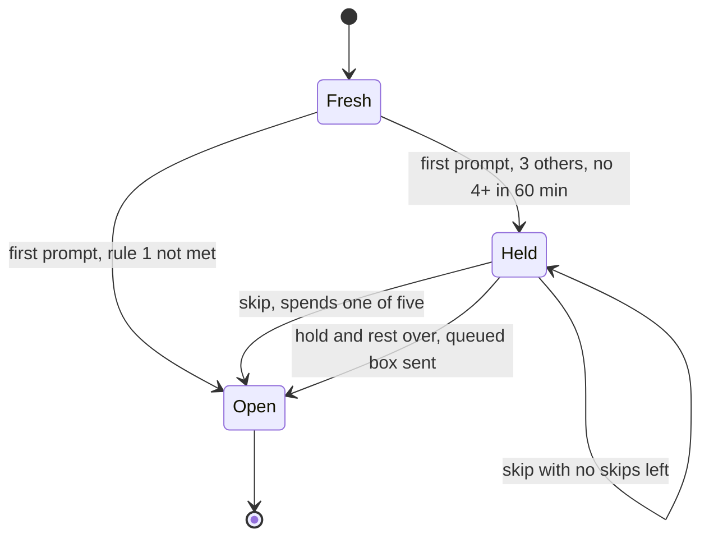

# Spec: the first prompt of a fourth session waits ten minutes

Extends `2026-09-19-zapara-status-file-design.md` (one field),
`2026-10-29-cognitive-load-powerbank-design.md` (the skip and its five a week)
and `2026-11-17-cognitive-load-queued-prompts-design.md` (Enter during a rest
sends the box when it ends). Everything not mentioned here stays as they say.
Part of [#253](https://github.com/drakulavich/cogload/issues/253).

## Objective

The number of sessions in an hour moves the index more than anything else.
Over 2026-10-24 to 2026-11-22 the mean index of an hour on the work Mac was 7,
20, 36, 55 and 76 for 1, 2, 3, 4 and 5+ sessions; at home 10, 22, 32, 63, 76
([#253 comment](https://github.com/drakulavich/cogload/issues/253)). 190 of the
work Mac's 310 active hours (61%) had four or more sessions. A note in the
band is easy to read past, as the 40-minute rest was before the plugin held
prompts. So the plugin holds the step that makes four: the first prompt of a
fresh session while three others already count.

After this change:

1. A fresh session's first composer prompt is held when the live `sessions` of the stored reading is exactly 3 and no reading
   in the last 60 minutes showed 4 or more (rule 2).
2. Every minute, a session whose reading shows `sessions >= 4` writes that
   reading's `asOf` to the store key `fourSeenAt`. Rule 1 reads it. One
   hold makes the count four, so a fifth session ten minutes later, or a
   new one after another went quiet, is not held: four or more was seen
   within the hour. The hold re-arms only after an hour below four, which is
   what an hourly crossing measures.
3. The hold lasts `restMin` minutes (10) from that prompt and ends on its own.
   It holds this session only; the other three keep working. During it the
   session behaves as during a rest: Enter queues the box, which is sent at
   the first minute after the hold (and any rest) has ended; a prompt with an
   attachment goes back into the box; text typed without Enter stays a draft.
4. A `skip:` line with a reason of three words or more lifts the hold and any
   running rest, and spends one of the five skips a week. With none left it
   gets the empty-powerbank text and the hold runs out on its own.
5. A rest that is running or starts during the hold holds the prompt too. The
   box goes when both have ended: the wait is the later of the two ends.
6. A Remote Control prompt passes, as during a rest, with no note. A fresh
   session whose reading is missing or older than 5 minutes (`STALE_MS`), or
   whose cogload is older than this field, is not held.
7. Each hold adds its start to the store key `fourthHolds`, kept for a week;
   the `/cogload` week line counts them.

## Approaches

### 1. What counts as a session

| Option | Cost | Verdict |
|---|---|---|
| A. The live bucket's `sessions` from `cogload status`: distinct sessions with a record in the last 60 minutes, the index's own count | +13 bytes in `status.json`; a session closed 30 minutes ago counts for 30 more | **Chosen** |
| B. The plugin's own count of open sessions: each session writes a heartbeat to the store every minute, `session.end` removes it | A map key every session rewrites each minute, so one write can drop another's entry; idle sessions left open for days count; sessions started before the update and machines without the plugin are missing | Rejected |
| C. Open (B) and active within the hour (A) | Both costs | Rejected |

A measures what the index scores and what the 61% counts, so the hold and its
measure agree. B counts a different thing: an open session that has been idle
for hours adds nothing to the index, and B would hold for it. A's lag is
accepted: a session closed half an hour ago still scores as one of the hour's
sessions, and the hold argues with the hour's score, not with the window list.
How often a hold fires on such a session the hourly JSON cannot say (below).

Subagents, `claude -p` and Agent SDK runs, and copied background history
already drop out of A in the parser (`isSidechain`, `entrypoint` `sdk-`, the
`bg` dedupe of `2026-10-17-cogload-copied-history-design.md`). No new filter.
The plugin only sees composer and bridge prompts, so a scripted session is
never held either. A `/clear` starts a new session id with `turns() === 0`,
and the index counts it as a new session, so the hold does too.

"Fresh" is `$.session.turns() === 0` inside `prompt.submit`: the engine's
count of user prompts in the transcript. A `--resume` session has more and is
never held. A fresh session has written no record yet, so the live count holds
only the other sessions, and 3 means this prompt makes four.

### 2. When the hold ends

| Option | What a month at work would have done | Verdict |
|---|---|---|
| A. When the count drops below four | Runs of 4+ hours last a median of 4 h, p90 10 h, max 11 h; 17 of 37 last 6 h or more. The 60-minute window adds up to an hour after a session goes quiet. No end the user can foresee | Rejected |
| B. A fixed `restMin` (10 min), ending on its own | 8 to 12 holds a week (37 in the month, below), 80 to 120 minutes of delayed first prompts a week, no skip needed | **Chosen** |
| C. Only by a skip | 8 to 12 skips a week against five: the powerbank is empty by Wednesday and rests run unskippable for the rest of the week | Rejected |

B has an end the band can show from the first second. Ten minutes is the
rest's length, so the band and the queue need no new timing.

### 3. With a rest and the five skips

| Option | Cost | Verdict |
|---|---|---|
| A. The hold waits for the rest, then runs its ten minutes | Up to 20 minutes for one prompt | Rejected |
| B. Both run side by side; the box goes when the later one ends | One `max` of two end times | **Chosen** |
| C. A rest replaces the hold | A rest with two minutes left gives a two-minute hold | Rejected |

The hold needs no skip, so the five are spent only by choice (the owner's
call, 2026-11-22). One skip in the held session lifts both, as one prompt asked
to go. A skip typed in another session lifts the rest there and leaves this
session's hold alone. A separate allowance for holds was not taken: one number
to explain is enough when the hold ends on its own.

## How often it fires

Counted over the work Mac's hourly buckets (`sessions` per clock hour) with a
scratch script. A crossing is an hour with 4+ sessions after an hour with
fewer.

| | Work | Home |
|---|---|---|
| Crossings in the month | 37, on 22 of 26 active days | 10, on 6 of 28 |
| Per full week | 9, 8, 8, 12 | 8, 0, 0, 1 |
| Fresh sessions opened in 4+ hours (estimate) | 177, 37 to 52 a week | 13 |

The last row is what holding every fourth-or-later session would have done,
which is why rule 2 holds only the crossing.

The live rule can sit off the 8 to 12 either way, and the hourly JSON cannot
say by how much:

- Lower: a crossing made by a resumed session (`turns() > 0`) is not held, and
  an hourly bucket with four distinct sessions may never have had three in
  the window at a fresh session's first prompt.
- Higher: a dip below four of more than an hour that does not fill a clock
  hour re-arms the live rule but shows no crossing in the buckets.
- Either: hours when no session ran the plugin write no `fourSeenAt`.

`fourthHolds` gives the real rate after two weeks. The exact count from the
past would need each session's first-record time beside the live count at that
moment. cogload's events hold both (`sessionId`, `ts`), but no output prints
them; that output is out of scope here.

## The hold's states



## Data and cost

- **`status.json`** gains a twelfth field, `sessions`, after `restMin`: the
  live bucket's count, an integer from 0. The line grows by 13 bytes
  (`,"sessions":3`), from 190 in the line printed today. Adding a field does not bump `schema`,
  which stays 1 (status-file spec, `schema` row). The plugin's
  `decodeStatus` accepts the line without it as today and reads a missing
  `sessions` as unknown, which never holds and raises no older-cogload
  toast. The `reading` store key stays an object.
- **`fourSeenAt`**, a new store key: one number, milliseconds, about 14 bytes.
  Written once a minute by each session whose reading shows 4 or more, which
  is the same rhythm as `reading` today.
- **`fourthHolds`**, a new store key: a list of numbers, the start of each hold
  for seven days, trimmed on each write as `rests` is. About 14 bytes an
  entry; 12 a week at work is about 170 bytes.
- **`holdUntil`**, a number in the session's `$.state`, in memory only, typed
  beside `queued` in `PluginState`. Not in the store: the hold is this
  session's, and the store is shared.

No existing key changes type (`CLAUDE.md`). No text is kept beyond `held`,
whose privacy line does not change. A session started before the update never
holds and writes neither key; an updated one reads a store without them as no
hold seen. The hold needs cogload with the `sessions` field, so the plugin
README's minimum version moves to that release.

## What the person sees

The held prompt's answer, in the held session:
`Queued for 14:52. Three other sessions ran this hour: a fourth waits 10 min. It stays in the box, and goes as it reads then.`
With an attachment:
`Three other sessions ran this hour: a fourth waits 10 min. Your prompt is back in the box: to send it, add "skip: <reason>" as its last line.`

The band, in the held session only:

| | 50 columns or wider | Narrower |
|---|---|---|
| Hold | `● Warming · 4th session until 14:52 (7 min) · 5 skips left` | `● Warming · 4th session until 14:52 (7 min)` |
| Hold and a rest ending first | `● Heating · rest until 14:48 · 4th session until 14:52 (11 min)` | `● Heating · 4th session until 14:52 (11 min)` |
| Hold inside a longer rest | today's rest band: `● Heating · rest until 14:55 (14 min) · 3 skips left` | `● Heating · rest until 14:55 (14 min)` |

The other sessions show today's band. The `/cogload` week line gains the holds
after the queued sends, only when there is one:
`This week: 1 rest taken, 2 fourth-session holds, 5 skips left.`

## Not in scope

- A cogload output of per-session first-record times, which the exact count
  of past crossings needs (an issue to file).
- The session count in the band outside a hold (the band text drafted in
  [#254](https://github.com/drakulavich/cogload/pull/254)).
- A hold for a fifth or later session, a separate skip allowance, a
  configurable threshold or length.

## Measure after a month

From the release date, `cogload trend --days 30` on the work Mac: the share of
active hours in the `4` and `5+` rows against 61% (190 of 310) before. Beside
it, the holds per week from the `/cogload` week line against the 8 to 12
crossings measured above.

## Project structure

```
src/lib/status/status.ts      sessions from day.live
plugin/hooks/register.ts      decodeStatus, the fresh-session rule, holdUntil, fourSeenAt,
                              fourthHolds, the band, the week line, sendQueued's end check
plugin/types/index.d.ts       sessions?: number in Status; holdUntil in PluginState
plugin/tests/register.test.ts cases below
tests/                        a status case for the field
README.md, plugin/README.md, docs/reference.md   the hold, the two keys, the field
```

## Testing strategy

`claude plugin test plugin` through the registered hooks, the engine's fake
clock and store, `$.session.turns()` answered with `on("session.turns")`.

1. Fresh session, reading `sessions: 3`, no `fourSeenAt` → the first prompt is
   dropped with the `Queued for` text and `fourthHolds` gains one entry.
   Fails on main.
2. The same with `sessions: 2` or `4`, or `turns` 1 → passes as typed.
3. `fourSeenAt` 59 minutes ago → passes; 61 minutes ago → held. Pins the hour.
4. A held session, the clock 10 minutes on, one tick → the box is sent once.
5. A held session and a rest ending 4 minutes after the hold → nothing at the
   hold's end; the box goes at the rest's end.
6. `skip: need it right now` in a held session → passes, `overrides` gains
   one; with five skips this week → the empty-powerbank text, still held.
7. A bridge prompt, a reading 6 minutes old, a reading without `sessions` →
   each passes, and no older-cogload toast.
8. A tick with `sessions: 4` writes `fourSeenAt`; with 3 it does not.
9. The band rows and the week line above, each at 50 and 49 columns.
10. `cogload status` on a fixture with three sessions in the hour → the line
    ends `"restMin":10,"sessions":3}`.

Before the code, one `claude --plugin-dir` run checks that `turns()` reads 0
in the first prompt's `prompt.submit`: the types do not say whether the
count includes the prompt being submitted.

## Definition of Done

Run today on main at `c655b88` (0.17.0):

| Command | Today | After |
|---|---|---|
| `cogload status \| jq -e 'has("sessions")'` | `false`, exit 1 | `true`, exit 0 |
| `grep -c fourthHolds plugin/hooks/register.ts` | `0`, exit 1 | 2 or more |
| `claude plugin test plugin` | `185 pass, 0 fail` | cases 1 to 9 pass; 1, 6 and 9 fail on main, 3 with the 60-minute check removed |
| `bun run check` | `384 pass, 1 skip, 0 fail` | passes, with case 10 |

- The `turns()` check above is done and its result written in the PR body.
- README, `plugin/README.md` and `docs/reference.md` describe the hold, the
  `sessions` field, the two store keys and the new minimum cogload version.
- The PR body carries the CHANGELOG line, including that sessions started
  before the update never hold.
