# Spec: a warning when more than three sessions are active

Replaces `2026-11-22-cogload-fourth-session-hold-design.md`: its hold goes, its
`sessions` field stays. Extends `2026-09-19-zapara-status-file-design.md` (two
fields). Issue: [#263](https://github.com/drakulavich/cogload/issues/263).
Changed on 2026-11-24 after 0.19.0: see "The repeat".

## Objective

The hold checks the first prompt of a fresh session (`turns() === 0`) with
exactly three others counted. The owner resumes sessions and keeps them open:
on 2026-11-24 all nine running Claude Code processes were `claude --resume`,
`sessions` was 6, and the store had no `fourthHolds` key two days after the
release. The owner asked for a warning while actively working in more than
three sessions, whichever way they were opened, to notice it and to spend less
time there.

After this change:

1. `cogload status` prints `activeSessions`: distinct sessions with the
   person's own action (`prompt`, `interrupt`, `reject`, `answer`, the
   `PRESENCE` kinds) in `(now − 30 min, now]`. Agent output and messages from
   other plugins or sessions do not make a session active. It also prints
   `singleActionSessions`: the active sessions with exactly one such action,
   leaving out the session of the latest action.
2. A composer prompt that passes to Claude marks its session `pending` with
   its time. The session takes a reading two seconds later when the latch is
   armed for a count of 5, and, as today, at `turn.complete` and every minute. A reading with
   `activeSessions` of 4 or more, a mark three minutes old or less and an armed
   latch show one toast in that session: `6 active sessions in 30 min, 2 with one action. Finish this one before the next.`
   With `singleActionSessions` 0 the text has no `, 2 with one action`. No session is named.
   It clears the mark and sets the latch. Nothing is held or delayed.
3. A toast sets the store key `overToastAt`, and nothing else does. The latch
   is armed when the key is absent, or 20 minutes old or more for a reading of
   5 or more, or 60 minutes old or more for a reading of exactly 4. So 5 or more
   warn three times an hour at most, and 4 once an hour. A reading of 4 with
   the key under an hour old leaves the mark as it is.
4. The band shows `6 sessions` after the level while the reading shows 4 or
   more, at 50 columns or wider and with no rest running.
5. The hold is removed: its answers, band text, week-line part, and the
   `asked` and `holdUntil` state. Rests, `skip:` and the powerbank do not change.
6. A reading older than 5 minutes (`STALE_MS`), or from a cogload without
   either new field, warns about nothing and shows no count.

## What counts as active

Measured on one Mac's transcripts, 2026-10-27 to 2026-11-24 (556 files, 0
skipped, 6039 human actions), with 0.19.0's latch (an hour below four) at four or more:

| Count | Actions at 4+ | Crossings | Not in a fresh session | Days | Per week, latest first |
|---|---|---|---|---|---|
| Own actions, 15 min | 3577 | 53 | 52 | 23 | 18, 10, 11, 14 |
| **Own actions, 30 min** | 4496 | 50 | 48 | 23 | 17, 9, 11, 13 |
| Own actions, 60 min | 5182 | 38 | 37 | 23 | 13, 9, 7, 9 |
| Any record, 60 min (`sessions`) | 5370 | 39 | 37 | 23 | 16, 9, 7, 7 |

A fresh session is one whose first record in the 28 days is at most a minute
before the crossing. Every row says the same of the hold: it could see 1 or 2
crossings in the month.

The owner chose 30 minutes on 2026-11-24. 15 drops a session left while Claude
works for a quarter of an hour; 60 keeps one that was closed long ago. `sessions` also counts a session where
only the agent works, which is not "actively working" in it. The plugin's own
count of open sessions was rejected in the earlier spec (shared-store writes,
idle sessions) and is not reopened.

At 30 minutes, 4496 of 6039 actions (74%) happen at four or more, so the count
in the band will be on most of the time. The toast, about 12 a week in 0.19.0, carries
the signal; the count is there to check it. The owner chose both on 2026-11-24
over a ten-minute hold and over a second Enter.

The session whose prompt makes the crossing had a single action on all 50, so
a hint that counts it would always show. Without it, 40 of the 50 have another
session with a single action. cogload does not know which session asks, so it
leaves out the one of the latest action: two seconds after the prompt that is
the asking one. At a later tick a newer action elsewhere can make the hint one
too high; accepted. Whether such
a session can be parked is a guess the data cannot check; the hint only says
that one exists.

## The repeat

0.19.0 toasted once and re-armed after an hour below four. On 2026-11-24 the
owner saw one toast, with 298 of the day's 370 actions (81%) at four or more,
and asked for up to three an hour to stay aware of the risk. Simulated on the
28 days before that, over 3434 prompts at four or more:

| Rule | Per week | Median a day | Most in a day | Within a minute of the last |
|---|---|---|---|---|
| **20 min at 5+, 60 min at exactly 4** | 69 | 13 | 20 | 0 |
| 20 min at 5+, at 4 only the first in an hour | 67 | 13 | 20 | 0 |
| 20 min at 4+ | 83 | 15 | 23 | 0 |
| Any three in an hour | 110 | 20 | 31 | 101 of 440 |
| One an hour | 38 | 7 | 11 | 0 |

The counts include prompts that cannot toast (a phone), so they are upper
bounds. The owner chose 20 minutes, then kept the repeat for 5 or more: 159 of
the 333 toasts of 20 minutes at 4+ were at exactly 4. The first row needs one
store key, the second two, for 2 toasts a week fewer.

```mermaid
stateDiagram-v2
    [*] --> Armed
    Armed --> Warned: own prompt, reading 4 or more; toast
    Warned --> ArmedFor5: 20 min
    ArmedFor5 --> Warned: own prompt, reading 5 or more; toast
    ArmedFor5 --> Armed: 60 min
```

## Data and cost

- `status.json` gains `activeSessions` and `singleActionSessions`, integers
  from 0, after `sessions`: `,"activeSessions":6,"singleActionSessions":2` is 44
  bytes on a one-line file. `schema` stays 1. Both are computed
  from the events already read, so no transcript is read for them. They travel on
  the day that holds `now`, so its JSON has both, under the same names. `sessions` stays, as a published field.
- `overToastAt` is one number, about 14 bytes, written once per toast.
  0.19.0 wrote `overSeenAt` at every reading of four or more. It is a new key: a
  session still on plugin 0.15.0 keeps moving `overSeenAt` forward, which would
  hold a shared latch shut.
- The shared reading moves from the key `reading` to `statusReading`, the same
  object with the two fields, about 250 bytes. A session on the old plugin
  rewrites `reading` without them (`decodeStatus` keeps only the fields it
  knows), and a new session would take that for up to a minute at a time and
  stay silent. While both versions run, each keeps its own reading: one more
  `cogload status` run a minute.
- `pending` is a number in the session's `$.state`, in memory only.
- `overSeenAt`, `fourSeenAt` and `fourthHolds` are no longer read or written. Nothing
  deletes them: an older session may still use them.
- The reading two seconds after a prompt is one more `cogload status` run, only
  while the latch is armed for a count of 5: 1829 runs in the 28 days against 713 with
  0.19.0's latch. Five runs took 0.7 to 1.3 s of wall time on the work Mac on
  2026-11-24, outside the turn (not awaited). It is there because a toast that waits for the
  minute tick can come after the person has left that terminal. It is not
  stored: the next minute would take it as fresh and start a due rest late.
- `$.store` has no atomic claim: two prompts in different sessions within
  milliseconds can both toast. Accepted, as for the hold.

No text, path or title is read for this. `PRIVACY.md` changes only its list of
store keys.

## Not in scope

- Holding or delaying a prompt, a configurable threshold or window, a toast
  for each session past the fourth, a system notification.
- A warning for a crossing made by an answer, an interrupt, a `/command` or a
  Remote Control prompt. The latch stays armed, so the next composer prompt in
  any session warns.
- The share in `/cogload` or the JSON: read once a month, and `cogload trend`
  already shows the hours at 4 and 5+ sessions.
- Naming the session to park: a title or path is not kept (`CLAUDE.md`).
- A count of warnings in the `/cogload` week line.

## Measure after a month

Thirty days after the release of the repeat, `bun run crowded-share 30` gives the
share of own actions made at four or more active sessions (the action's own
included). It was 74% (4496 of 6039) on 2026-11-24. Above 65% the warning did
not change the work, and the owner chooses between changing and removing it.
The owner set 65% on 2026-11-24.
[#265](https://github.com/drakulavich/cogload/issues/265) holds the check.

## Testing strategy

Plugin cases run through the registered hooks with the engine's fake clock and
store; the CLI ones through `analyze()` and the CLI on fixtures.

1. `turns` 7, reading `activeSessions: 4`, no latch: a composer prompt passes
   as typed and one toast appears after two seconds. Fails on main.
2. The same with 3: no toast. With `sessions: 6` and 3 active: no toast.
3. A reading of 4 at a tick with no prompt in this session: no toast, and
   `overToastAt` stays absent. A prompt in another session then toasts.
4. At 5 active, the stored latch 19 minutes old: no toast; 20: toast. At exactly
   4, 59 minutes old: no toast; 60: toast. At 5, 20 minutes fails on 0.19.0.
5. A tick reading 4 leaves a stored latch as it is, and a newer `overSeenAt`
   does not stop the toast. Fails on 0.19.0.
6. The two-second reading is still 3 and the next tick reads 4: toast at 3
   minutes after the prompt, none at 3 minutes and 1 ms.
7. A second prompt 10 minutes after the toast, at 5: no second toast. A prompt
   20 minutes after it toasts again at 5. Fails on 0.19.0. At 4 it does not, and
   a reading of 5 within three minutes of that prompt toasts.
8. A bridge prompt, a prompt held by a rest, a reading 6 minutes old and a
   reading without `activeSessions`: no toast, no older-cogload toast.
9. A fresh session (`turns` 0) at `sessions: 3`: its prompt passes. Fails on main.
10. The band at 50 columns shows `● Heating · 6 sessions · streak 25m`; at 49,
    at 3 active and during a rest it has no count.
11. Four sessions with a prompt, a fifth with agent records only:
    `activeSessions` is 4 and `sessions` 5. A prompt exactly 30 minutes old is
    out, 1 ms newer is in. An `answer` alone counts.
12. `cogload status` on that fixture ends
    `"sessions":5,"activeSessions":4,"singleActionSessions":2}`: one of the four
    has two prompts, and the latest action is in another. With the latest action
    in the one with two prompts it is 3.
13. `singleActionSessions` 2 and 0: the toast with and without the hint.
14. A composer prompt with the latch armed runs `cogload status` two seconds
    later; with a latch 10 minutes old it runs nothing until `turn.complete` or
    the minute.
15. A `reading` ten seconds old without the new fields, as the old plugin writes
    it, does not stop the toast or the band's count.

## Definition of Done

Run on main at `baa4369` (0.18.0):

| Command | Today | After |
|---|---|---|
| `cogload status \| jq -e 'has("activeSessions")'` | `false` | `true` |
| `git grep -c -E 'fourthHolds\|holdIfFourth' -- plugin/hooks/register.ts` | 5 | no match |
| `claude plugin test plugin` | 207 pass, 0 fail | cases 1 to 10 and 13 to 15 pass; 1 and 9 were seen to fail on main |
| `bun run check` | 409 pass, 1 skip, 0 fail | passes, with 11 and 12 |

- In an interactive `claude --plugin-dir plugin --resume` with three other
  sessions prompted in the last half hour, a typed prompt raises the toast.
- README, `plugin/README.md`, `docs/reference.md` and `PRIVACY.md` describe
  the warning, the two fields, the two store keys and the new minimum cogload version.
  No text describes the hold except the earlier spec, marked replaced.

For the repeat, run on main at `4a915fe` (0.19.0):

| Command | Today | After |
|---|---|---|
| `git grep -c overToastAt -- plugin/hooks/register.ts` | no match | 2 or more |
| `git grep -c overSeenAt -- plugin/hooks/register.ts` | 6 | no match |
| `claude plugin test plugin` | 213 pass, 0 fail | passes; 4, 5 and 7 were seen to fail on main |
| `bun run check` | 413 pass, 1 skip, 0 fail | passes |

- `plugin/README.md` and `docs/reference.md` describe the 20 and 60 minutes and `overToastAt`.
