# Spec: a warning when more than three sessions are active

Replaces `2026-11-22-cogload-fourth-session-hold-design.md`: its hold goes, its
`sessions` field stays. Extends `2026-09-19-zapara-status-file-design.md` (two
fields). Issue: [#263](https://github.com/drakulavich/cogload/issues/263).

## Objective

The hold checks the first prompt of a fresh session (`turns() === 0`) with
exactly three others counted. The owner resumes sessions and keeps them open:
on 2026-11-24 all nine running Claude Code processes were `claude --resume`,
`sessions` was 6, and the store had no `fourthHolds` key two days after the
release. The owner asked for a warning while actively working in more than
three sessions, whichever way they were opened, to notice it and to spend less
time there.

After this change:

1. `cogload status` prints `activeSessions`: distinct sessions with the
   person's own action (`prompt`, `interrupt`, `reject`, `answer`, the
   `PRESENCE` kinds) in `(now − 30 min, now]`. Agent output and messages from
   other plugins or sessions do not make a session active. It also prints
   `singleActionSessions`: the active sessions with exactly one such action.
2. A composer prompt that passes to Claude marks its session `pending` with
   its time. Two seconds later, and again at `turn.complete` and every minute,
   the session takes a reading. A reading with `activeSessions` of 4 or more,
   a mark three minutes old or less and an armed latch show one toast in that
   session: `6 active sessions in 30 min, 2 with one action. Park one before the next.`
   With `singleActionSessions` 0 the text has no `, 2 with one action`. No session is named.
   It clears the mark and sets the latch. Nothing is held or delayed.
3. The latch is the store key `overSeenAt`. It is armed when absent or 60
   minutes old or more. While it is not armed, any session whose reading shows
   4 or more moves it forward to the reading's `asOf`. An armed latch is set
   only by a toast, so a background session cannot use up the warning.
   It re-arms after an hour below four.
4. The band shows `6 sessions` after the level while the reading shows 4 or
   more, at 50 columns or wider and with no rest running.
5. The hold is removed: its answers, band text, week-line part, and the
   `asked` and `holdUntil` state. Rests, `skip:` and the powerbank do not change.
6. A reading older than 5 minutes (`STALE_MS`), or from a cogload without
   either new field, warns about nothing and shows no count.
7. `/cogload` gains a line after the hour line: `74% of today's 120 actions at
   4+ sessions.` An action is at 4+ when `activeSessions`, measured at its own
   time and counting it, is 4 or more. No line on a day without actions, or
   from a cogload without the field.

## What counts as active

Measured on one Mac's transcripts, 2026-10-27 to 2026-11-24 (556 files, 0
skipped, 6039 human actions), with the latch rule above at four or more:

| Count | Actions at 4+ | Crossings | Not in a fresh session | Days | Per week, latest first |
|---|---|---|---|---|---|
| Own actions, 15 min | 3577 | 53 | 52 | 23 | 18, 10, 11, 14 |
| **Own actions, 30 min** | 4496 | 50 | 48 | 23 | 17, 9, 11, 13 |
| Own actions, 60 min | 5182 | 38 | 37 | 23 | 13, 9, 7, 9 |
| Any record, 60 min (`sessions`) | 5370 | 39 | 37 | 23 | 16, 9, 7, 7 |

A fresh session is one whose first record in the 28 days is at most a minute
before the crossing. Every row says the same of the hold: it could see 1 or 2
crossings in the month.

The owner chose 30 minutes on 2026-11-24. 15 drops a session left while Claude works for a quarter of an hour; 60
keeps one that was closed long ago. `sessions` also counts a session where
only the agent works, which is not "actively working" in it. The plugin's own
count of open sessions was rejected in the earlier spec (shared-store writes,
idle sessions) and is not reopened.

At 30 minutes, 4496 of 6039 actions (74%) happen at four or more, so the count
in the band will be on most of the time. The toast, about 12 a week, carries
the signal; the count is there to check it. The owner chose both on 2026-11-24
over a ten-minute hold and over a second Enter.

In 3038 of the 4501 actions at 4+ (67%, counted an hour later, hence 5 more
than the table) at least one active session had a single action. Whether such
a session can be parked is a guess the data cannot check; the hint only says
that one exists.

## The latch

```mermaid
stateDiagram-v2
    [*] --> Armed
    Armed --> Warned: own prompt, reading 4 or more; toast
    Warned --> Warned: any session reads 4 or more
    Warned --> Armed: 60 min with no reading of 4 or more
```

## Data and cost

- `status.json` gains `activeSessions` and `singleActionSessions`, integers
  from 0, after `sessions`: `,"activeSessions":6,"singleActionSessions":2` is 44
  bytes on a one-line file. `schema` stays 1. Both are computed in the existing live fold from the events already read, so no
  transcript is read for them. `sessions` stays, as a published field.
- Each `Day` of the JSON gains `actions` and `crowdedActions`, two integers,
  34 bytes a day (`,"actions":120,"crowdedActions":89`). A sliding
  30-minute window over the actions gives both in one pass; the three-hour
  look-back already covers the first half hour of a day. A list of actions with
  their counts was not considered: the share needs two sums.
- `overSeenAt` is one number, about 14 bytes, with the write rhythm
  `fourSeenAt` has. It is a new key: a session started before the update
  still writes `fourSeenAt` from the other count, which would disarm the warning.
- `pending` is a number in the session's `$.state`, in memory only.
- `fourSeenAt` and `fourthHolds` are no longer read or written. Nothing
  deletes them: an older session may still use them.
- The reading two seconds after a prompt is one more `cogload status` run per
  prompt. A run took 1.2 s of wall time on the work Mac on 2026-11-24, outside
  the turn (not awaited). It is there because a toast that waits for the
  minute tick can come after the person has left that terminal.
- `$.store` has no atomic claim: two prompts in different sessions within
  milliseconds can both toast. Accepted, as for the hold.

No text, path or title is read for this. `PRIVACY.md` changes only its list of
store keys.

## Not in scope

- Holding or delaying a prompt, a configurable threshold or window, a toast
  for each session past the fourth, a system notification.
- A warning for a crossing made by an answer, an interrupt, a `/command` or a
  Remote Control prompt. The latch stays armed, so the next composer prompt in
  any session warns.
- A repeat of the toast while the count stays at four or more.
- Naming the session to park: a title or path is not kept (`CLAUDE.md`).
- A count of warnings in the `/cogload` week line.

## Measure after a month

Thirty days after the release, `cogload --days 30 --json` gives the share, the sum of
`crowdedActions` over the sum of `actions`. It is 74% today. Above 65% the
warning did not change the work, and the owner chooses between a repeat and
removing it. The owner set 65% on 2026-11-24.

## Testing strategy

Plugin cases run through the registered hooks with the engine's fake clock and
store; the CLI ones through `analyze()` and the CLI on fixtures.

1. `turns` 7, reading `activeSessions: 4`, no latch: a composer prompt passes
   as typed and one toast appears after two seconds. Fails on main.
2. The same with 3: no toast. With `sessions: 6` and 3 active: no toast.
3. A reading of 4 at a tick with no prompt in this session: no toast, and
   `overSeenAt` stays absent. A prompt in another session then toasts.
4. The stored latch 59 minutes old: no toast; 60: toast.
5. A latch 59 minutes old and a tick reading 4 moves it to `asOf`, keeping a
   newer stored value; a reading of 3 leaves it.
6. The two-second reading is still 3 and the next tick reads 4: toast at 3
   minutes after the prompt, none at 3 minutes and 1 ms.
7. A second prompt after the toast, still at 4: no second toast.
8. A bridge prompt, a prompt held by a rest, a reading 6 minutes old and a
   reading without `activeSessions`: no toast, no older-cogload toast.
9. A fresh session (`turns` 0) at `sessions: 3`: its prompt passes. Fails on main.
10. The band at 50 columns shows `● Heating · 6 sessions · streak 25m`; at 49,
    at 3 active and during a rest it has no count.
11. Four sessions with a prompt, a fifth with agent records only:
    `activeSessions` is 4 and `sessions` 5. A prompt exactly 30 minutes old is
    out, 1 ms newer is in. An `answer` alone counts.
12. `cogload status` on that fixture ends
    `"sessions":5,"activeSessions":4,"singleActionSessions":3}`: one of the four
    has two prompts.
13. `singleActionSessions` 2 and 0: the toast with and without the hint.
14. A day with 10 actions, 7 of them at 4+: `actions` 10, `crowdedActions` 7,
    and `/cogload` shows `70% of today's 10 actions at 4+ sessions.` No actions:
    no line. An action just after midnight counts the sessions before it.

## Definition of Done

Run on main at `baa4369` (0.18.0):

| Command | Today | After |
|---|---|---|
| `cogload status \| jq -e 'has("activeSessions")'` | `false` | `true` |
| `git grep -c overSeenAt -- plugin/hooks/register.ts` | no match | 2 or more |
| `git grep -c -E 'fourthHolds\|holdIfFourth' -- plugin/hooks/register.ts` | 5 | no match |
| `claude plugin test plugin` | 207 pass, 0 fail | cases 1 to 10, 13 and the `/cogload` line of 14 pass; 1 and 9 were seen to fail on main |
| `bun run check` | 409 pass, 1 skip, 0 fail | passes, with 11, 12 and 14 |
| `cogload --days 30 --json \| jq -e '.[0] \| has("crowdedActions")'` | `false` | `true` |

- In an interactive `claude --plugin-dir plugin --resume` with three other
  sessions prompted in the last half hour, a typed prompt raises the toast.
- README, `plugin/README.md`, `docs/reference.md` and `PRIVACY.md` describe
  the warning, the field, the store key and the new minimum cogload version.
  No text describes the hold except the earlier spec, marked replaced.
